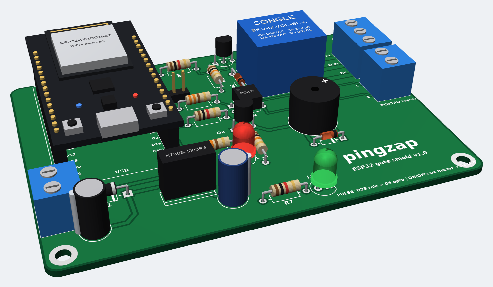

# pingzap

**English** | [Português (Brasil)](README.pt-BR.md)

A bridge between WhatsApp and ESP32 boards over MQTT, managed from a web
interface. WhatsApp contacts and groups talk to **bots**, and the bots send
commands to the boards:

- **Flow bot**: a menu-driven chatbot. Gate example: someone sends `/start`,
  the bot replies "Type 1 to open the gate"; on `1`, pingzap publishes `PULSE`
  to the ESP32's queue, the board pulses the relay, and the bot asks whether
  the gate opened.
- **Alert bot**: when a configured contact sends a message (with an optional
  keyword), the ESP32 blinks its LED and sounds the buzzer; when I reply, the
  alert stops.

The web interface does everything: pairs WhatsApp by QR code, registers the
boards and their queue names (MQTT topics), creates the bots and picks which
contact or group uses each one. The boards fetch the queues they must use from
the pingzap API.

## Gate bot flow

```
 person (WhatsApp)              pingzap                       ESP32
    │── /start ────────────────────▶│                             │
    │◀─ "The gate is closed.        │                             │
    │    *1* - Open the gate"       │                             │
    │── 1 ─────────────────────────▶│── PULSE to <cmd queue> ────▶│ relay pulse
    │◀─ "Did the gate open?         │                             │
    │    *1* - Yes  *2* - No"       │                             │
    │── 2 ─────────────────────────▶│── PULSE (new attempt) ─────▶│ relay pulse
    │◀─ "Did the gate open?" ...    │                             │
    │   (no answer for 3 min)       │                             │
    │◀─ "I still need your answer:  │                             │
    │    Did the gate open?"        │                             │
    │── 1 ─────────────────────────▶│ state = open                │
    │◀─ "Gate open."                │                             │
    │── /menu ─────────────────────▶│                             │
    │◀─ "The gate is open.          │                             │
    │    *1* - Close the gate       │                             │
    │    *2* - Report the gate was  │                             │
    │          closed by the remote"│                             │
```

The bot texts are in Portuguese and editable on the web; the ready-made gate
template ships in Portuguese.

### Flow bot rules

- The bot is a **state machine**. The current state (e.g. closed/open) is one
  per bot, shared by all of its contacts and groups.
- Each state has a numbered menu. Each option may:
  - publish a **command** to the command topic of the bot's device;
  - ask a **confirmation question** (`1` Yes / `2` No). On `2` the command is
    published again and the question repeats, up to the flow's **attempt**
    limit (0 = unlimited);
  - **change the state** when the confirmation is `1`, or right away when
    there is no confirmation.
- An option may have a **shortcut** (e.g. `/abrir`, `/fechar`) that runs it
  straight away, skipping the menu, with the same confirmation, attempts and
  reminders. A shortcut only works in the state where its option exists:
  `/abrir` with the gate already open answers with the current menu. The menu
  shows each option's shortcut.
- An option without a command only changes the state. That is how to report
  the gate was opened or closed some other way (with the remote). The state
  can also be set on the **Bots** page.
- While a confirmation is unanswered, the bot **insists** every N minutes (3 by
  default) until the person replies.
- If nobody answers after N reminders (3 by default, about 9 minutes), the bot
  **fires the device alarm** by publishing `ON` (blinking LED and buzzer) and
  says so in the chat, so someone checks what is going on. Reminders keep
  going. The first answer in the chat turns the alarm off by publishing `OFF`
  and the flow carries on. The reminder count and commands are configurable;
  0 disables the alarm.
- Outside a conversation, the bot only reacts to the start (`/start`) or menu
  (`/menu`) command; other messages in the chat are ignored.
- If someone else changes the state while a menu is open, the bot shows the
  updated menu instead of running the stale option.
- Messages sent by the paired account itself are not treated as answers,
  since the bot writes from it.
- Saving a bot restarts its ongoing conversations.
- Messages older than **1 minute** are ignored by every bot. When pingzap
  reconnects to WhatsApp (after a restart or an internet outage), WhatsApp
  delivers what arrived while it was offline; those messages are discarded
  so old commands, such as `/abrir`, do not pulse the gate again. Anyone who
  wrote during the outage must send the command again.

### Alert bot rules

- A message from one of the bot's contacts or groups publishes the ON command
  (`ON` by default). With a **keyword** (e.g. `/urgente`), only messages
  containing it trigger: matching ignores case and covers text and media
  captions.
- When I reply, from any device, that chat stops awaiting a reply. Once nobody
  is waiting, pingzap publishes the OFF command (`OFF`).
- Pending alerts live in memory only: after restarting pingzap, the next reply
  turns the alert off.

### Contacts and groups

- Each contact or group talks to **a single bot**.
- Contacts are entered as area code + phone (`55` is added) or picked from the
  WhatsApp contact list. Older accounts without the ninth digit are recognized.
- In groups, any member can use the bot.

## Architecture

Diagrams of how everything connects (WhatsApp, pingzap, MQTT, ESP32, Grafana)
and of the flows (in Portuguese): [docs/arquitetura.md](docs/arquitetura.md).

```
pingzap/
├── cmd/pingzap/main.go     # wires the parts and starts the web server
├── internal/
│   ├── config/             # .env: broker, databases, HTTP address
│   ├── store/              # SQLite: users, sessions, devices, bots, conversations
│   ├── flow/               # flow engine (state machine), no I/O
│   ├── bot/                # routes messages to the right bot, alerts, reminders, telemetry
│   ├── alert/              # which chats still await a reply (alert bots)
│   ├── phone/              # Brazilian phone number normalization
│   ├── whatsapp/           # session, QR code, contacts, groups, sending
│   ├── mqtt/               # broker connection, publishing, subscriptions
│   ├── metrics/            # writes telemetry to InfluxDB (for Grafana)
│   └── web/                # REST API + embedded interface (dist/)
├── web/                    # React interface (Vite)
├── firmware/pingzap/       # ESP32 sketch
├── mosquitto/              # docker-compose local broker
├── grafana/                # Grafana datasource and dashboard (provisioned)
└── docker-compose.yml
```

There are two SQLite databases: `pingzap.db` holds pingzap's data and
`whatsapp.db` holds the WhatsApp session.

## Running

### With Docker (recommended)

```sh
cp .env_example .env    # set the broker passwords
docker compose up -d --build
```

Open `http://localhost:8080`:

1. **First access**: create the admin user. Other users can be added under
   **Usuários**.
2. **WhatsApp**: click **Conectar** and scan the QR code on your phone, under
   *Linked devices > Link a device*.
3. **Dispositivos**: register the ESP32, with name, client ID and the three
   topics (**Sugerir** fills in the topics), and copy its **token**.
4. **Bots**: create a bot. **Novo bot de portão** comes with the gate flow
   ready. Pick the device and the contacts or groups, then save.

Compose also starts the Mosquitto broker (see the
[broker guide](docs/broker.md)), InfluxDB and Grafana. pingzap's databases
live in `./data`.

### Graphs (Grafana)

pingzap writes every board's telemetry to InfluxDB (bucket `pingzap`, kept
for 90 days). Grafana runs at `http://localhost:3000` (user `admin`, password
`GRAFANA_PASSWORD` from `.env`) and opens on the **pingzap — Dispositivos**
dashboard, with the datasource already set up:

- online/offline status and broker connection over time;
- alert (LED and buzzer) on/off;
- relay pulses and alerts fired in the period;
- Wi-Fi signal, free memory and uptime;
- latest commands received.

The **Dispositivo** selector filters by board (by the name registered on the
web). The dashboard is provisioned from `grafana/dashboards/pingzap.json`; to
change it for good, edit that file, since changes made only in the UI are
lost when the container is recreated.

### Without Docker

Requirements: Go, a C compiler (the SQLite driver uses cgo) and Node 18+ for
the interface.

```sh
cd web && npm install && npm run build && cd ..   # writes internal/web/dist
go run ./cmd/pingzap
```

To work on the interface with live reload, run pingzap and, in another
terminal, `cd web && npm run dev`. Vite proxies `/api` to port 8080.

Tests:

```sh
go test ./...
```

## Configuration (.env)

Only the infrastructure lives in `.env`. Everything else is configured on the
web.

| Variable                | Default                              | Description |
|-------------------------|--------------------------------------|-------------|
| `PINGZAP_MQTT_BROKER`   | `wss://broker.emqx.io:8084/mqtt`     | Broker URL (compose: `tcp://mosquitto:1883`). |
| `PINGZAP_MQTT_USERNAME` | empty                                | pingzap's broker username. |
| `PINGZAP_MQTT_PASSWORD` | empty                                | pingzap's broker password. |
| `ESP32_MQTT_USERNAME`   | —                                    | ESP32 username, created on the local broker by compose. |
| `ESP32_MQTT_PASSWORD`   | —                                    | ESP32 password on the local broker. |
| `PINGZAP_HTTP_ADDR`     | `:8080`                              | Address of the web interface and API. |
| `PINGZAP_DB`            | `file:pingzap.db?_foreign_keys=on`   | Database with users, devices and bots. |
| `PINGZAP_WHATSAPP_DB`   | `file:whatsapp.db?_foreign_keys=on`  | Database with the WhatsApp session. |
| `INFLUXDB_PASSWORD`     | —                                    | InfluxDB `admin` password (compose). |
| `INFLUXDB_TOKEN`        | —                                    | InfluxDB token, used by pingzap and Grafana (compose). |
| `GRAFANA_PASSWORD`      | —                                    | Grafana `admin` password (compose). |
| `PINGZAP_INFLUX_URL`    | empty                                | InfluxDB that receives the telemetry; empty disables it (compose: `http://influxdb:8086`). |
| `PINGZAP_INFLUX_TOKEN`  | empty                                | InfluxDB token (compose: `INFLUXDB_TOKEN`). |
| `PINGZAP_INFLUX_ORG`    | `pingzap`                            | InfluxDB organization. |
| `PINGZAP_INFLUX_BUCKET` | `pingzap`                            | InfluxDB bucket. |

**Migrating from the previous version:** if `.env` still has
`PINGZAP_NUMBERS` (with `PINGZAP_KEYWORD` and the old topics/payloads) and the
database is empty, pingzap creates a device and an alert bot from them, once.
After that those variables are ignored.

## ESP32

A base board for the ESP32 (relay, isolated gate output, buzzer, LED and
7-24 V supply), with schematic and Gerber files ready to order from PCBWay,
is in [hardware/](hardware/README.md).



The sketch is at `firmware/pingzap/pingzap.ino` and needs the `PubSubClient`,
`ArduinoJson` (v7) and `WiFiManager` (tzapu, 2.0.x) libraries.

```sh
cp firmware/pingzap/secrets_example.h firmware/pingzap/secrets.h
```

`secrets.h` only holds defaults: the password of the setup network
(`PORTAL_PASSWORD`) and the initial values of the broker (`mqtt_server`,
`mqtt_user`, `mqtt_pass`) and of the pingzap API (`api_url`, `device_token`).

### Wi-Fi and settings (setup page)

The Wi-Fi is not in the code. When the board finds no known network, it opens
its own network **`pingzap-XXXX`** (password `PORTAL_PASSWORD`) and turns the
LED on:

1. Connect to `pingzap-XXXX` from your phone; the setup page opens by itself
   (or go to `http://192.168.4.1`).
2. Tap **Configure WiFi**, pick the network and type its password.
3. Check the broker, the pingzap API (e.g. `http://192.168.0.10:8080`) and the
   device token (from the **Dispositivos** page), then save.

Everything is kept in the ESP32's flash and survives reboots and new
firmware uploads. To change networks or servers later, **hold the BOOT button
for 3 s**: outputs turn off and the page opens. Unused, the page closes after
3 minutes and the board tries the saved network again.

On boot the board asks the API for its client ID and topics, and only then
connects to the broker. Every minute it checks the configuration again; if
the topics changed on the web, it reconnects with the new ones.

### Commands

| Payload | Effect |
|---------|--------|
| `ON`    | Starts the alert: blinking LED and buzzer. |
| `OFF`   | Ends the alert. |
| `PULSE` | Drives the gate: `GATE_PIN` (D5) and the relay (`RELAY_PIN`, D23) stay on together for 1 s (`RELAY_PULSE_MS`). |

### Telemetry

The board publishes to the telemetry topic every 5 s and on every command it
receives, always with the same fields:

```json
{"device": "esp-portao", "uptime_s": 3600, "wifi_rssi": -61, "free_heap": 210452,
 "alert": false, "relay": true, "event": "PULSE"}
```

| Field       | Meaning |
|-------------|---------|
| `uptime_s`  | Seconds since the board booted. |
| `wifi_rssi` | Wi-Fi signal, in dBm. |
| `free_heap` | Free memory, in bytes. |
| `alert`     | Alert (LED and buzzer) on. |
| `relay`     | Gate pulse (D5 and D23) in progress. |
| `event`     | Command that caused the message (`ON`, `OFF`, `PULSE`); absent on the periodic report. |

The `online` / `offline` status goes to the status topic (LWT, retained). The
**Dispositivos** page shows the last message and the status, and Grafana keeps
the history.

Whenever it connects to the Wi-Fi, on boot or after a drop, the LED blinks 3
times.

### Buzzer

Wire its positive leg to `D4` (GPIO 4) and the other leg to `GND`. The sketch
drives a passive buzzer with a 2 kHz tone (`BUZZER_FREQ`).

## Notes

- The web interface and API use plain HTTP, without TLS. Expose them only on
  the local network or behind a reverse proxy with HTTPS.
- Anyone with access to the interface can open the gate and pair WhatsApp;
  create users only for those who need it.
- Each device token grants access to that board's configuration. If one
  leaks, generate a new one on **Dispositivos**.
- `whatsapp.db` grants access to the WhatsApp account, `pingzap.db` holds the
  system data, `.env` has the broker passwords and `secrets.h` the setup page's.
  All of them are in `.gitignore` and must not be committed.
- Commands are not retained by the broker: if the ESP32 is off when a command
  is published, it does not receive it. In flow bots, the confirmation
  question makes that visible to whoever asked.
