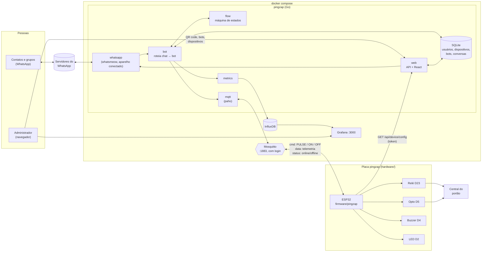
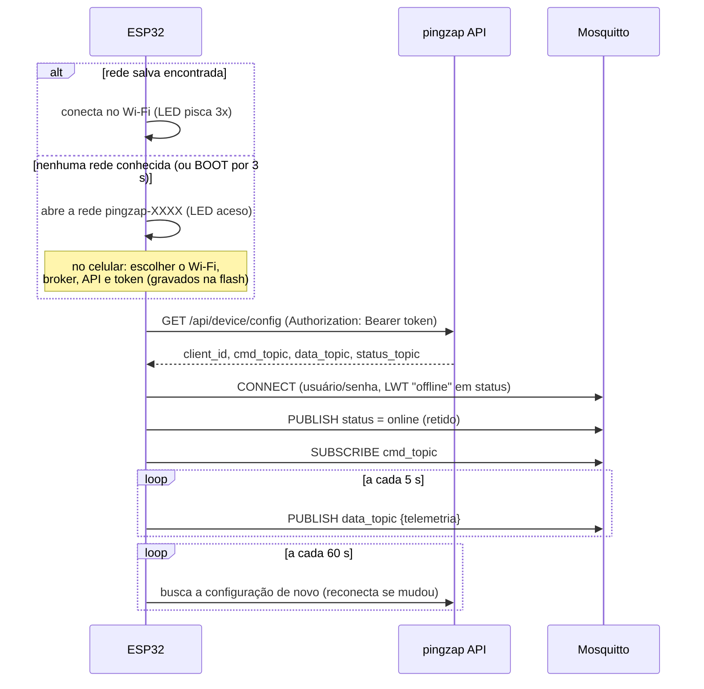
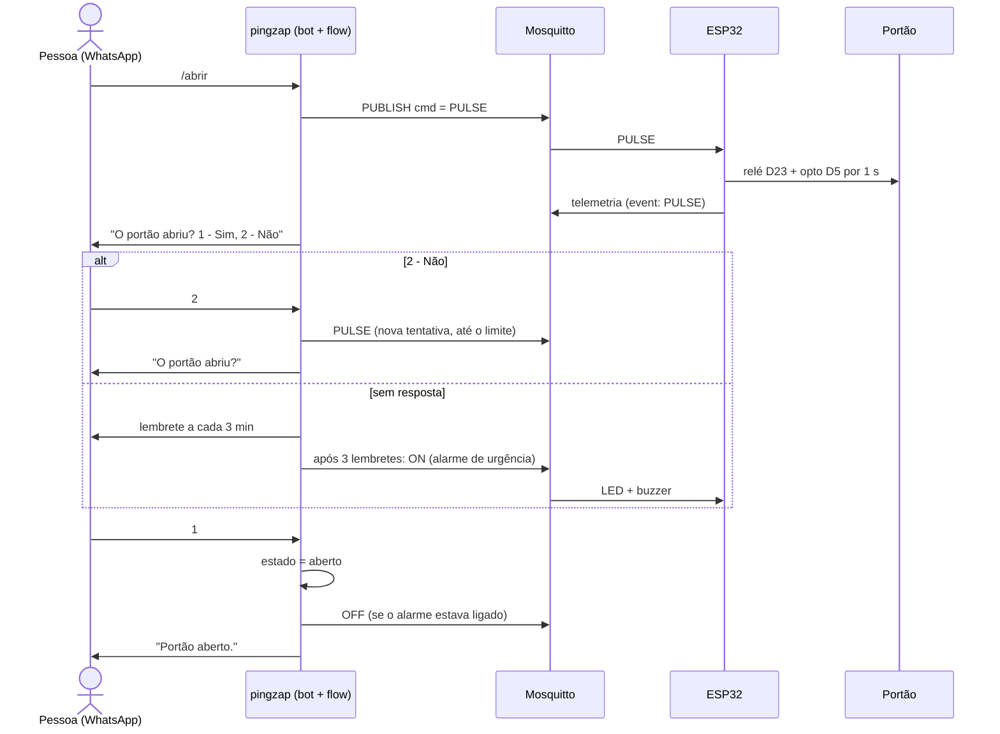
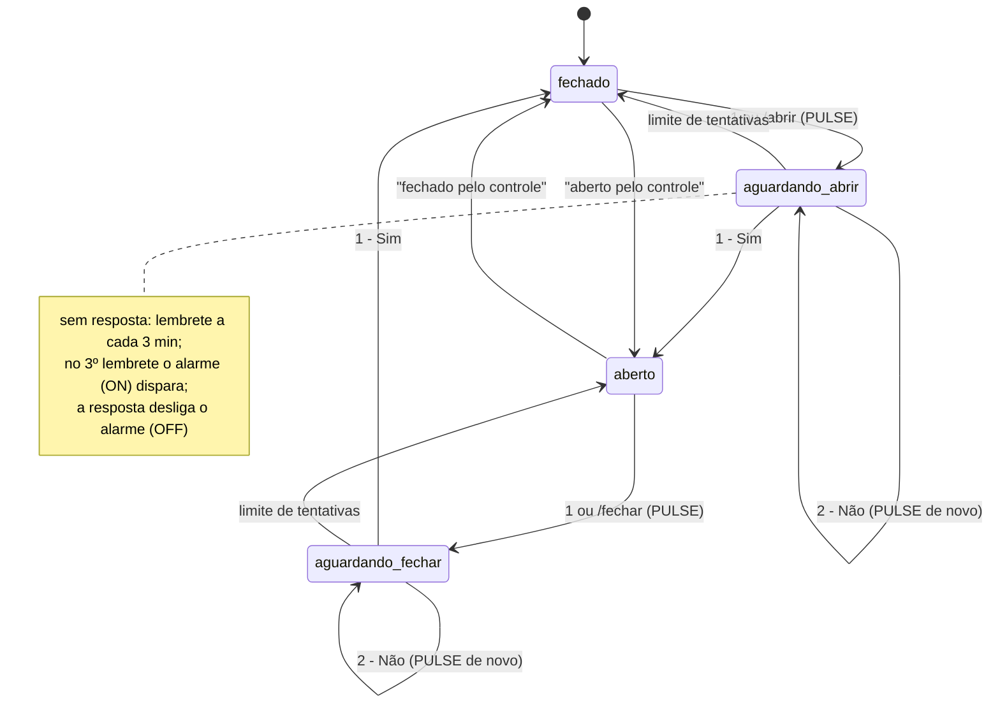
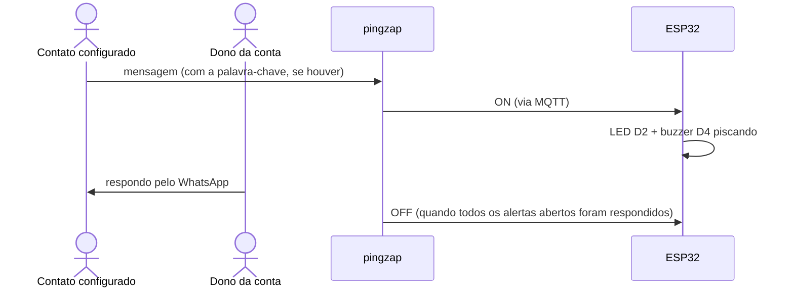

# Arquitetura do pingzap

Como as peças do pingzap se ligam, do WhatsApp até o portão. Os diagramas
estão em Mermaid, que o GitHub desenha sozinho.

## Visão geral

- O **pingzap** entra no WhatsApp como aparelho conectado; o pareamento é
  feito pelo QR code na página *WhatsApp*.
- Cada contato ou grupo é ligado a um **bot**, e cada bot a um
  **dispositivo**. Esse vínculo fica no SQLite e é editado na web.
- O **ESP32** não tem Wi-Fi fixo no código: sem rede conhecida, abre a
  rede `pingzap-XXXX` com uma página para escolher o Wi-Fi, o broker, a API e
  o token. Depois busca na API, com o seu token, o client ID e os tópicos que
  deve usar. Depois só fala MQTT com o Mosquitto.
- A telemetria passa pelo pingzap: ele grava o último dado no SQLite (para a
  página *Dispositivos*) e envia a série ao InfluxDB, que o Grafana mostra.

A placa do ESP32 (relé e saída isolada para o portão, buzzer, LED e fonte),
desenhada em `hardware/`:

## Tópicos MQTT

Os tópicos são cadastrados por dispositivo na web. O padrão sugerido é
`pingzap/<client_id>/...`.

| Tópico | Sentido | Conteúdo |
|---|---|---|
| comando (`.../cmd`) | pingzap → ESP32 | `PULSE` aciona o portão (relé D23 e opto D5 por 1 s) `ON` liga o alarme (LED D2 e buzzer D4 piscando) `OFF` desliga o alarme |
| telemetria (`.../data`) | ESP32 → pingzap | JSON a cada 5 s e a cada comando: `device`, `uptime_s`, `wifi_rssi`, `free_heap`, `alert`, `relay`, `event` |
| status (`.../status`) | ESP32 → pingzap | `online` ao conectar; `offline` pelo Last Will (retido) |

## Partida do ESP32

## Bot de fluxo: abrir o portão

Mesmo fluxo para `/start` → menu → `1`, ou direto pelo atalho `/abrir`.
Mensagens com mais de 1 minuto são descartadas antes de chegar ao bot: ao
reconectar, o WhatsApp entrega o que chegou com o pingzap fora do ar, e esses
comandos antigos não podem pulsar o portão.

## Máquina de estados do portão

O estado é um só por bot, compartilhado por todos os contatos e grupos dele.

## Bot de alerta

## Onde fica cada parte

| Pasta | Conteúdo |
|---|---|
| `cmd/pingzap` | ponto de entrada: liga store, MQTT, WhatsApp, bots, métricas e HTTP |
| `internal/whatsapp` | conexão whatsmeow, QR code, contatos e grupos, envio |
| `internal/bot` | roteamento chat → bot, bots de fluxo e de alerta, lembretes, telemetria |
| `internal/flow` | máquina de estados pura (menus, atalhos, confirmação, alarme) |
| `internal/store` | SQLite: usuários, sessões, dispositivos, bots, conversas |
| `internal/web` + `web/` | API em Go e interface em React (embutida no binário) |
| `internal/mqtt` | cliente MQTT com reconexão e assinaturas dinâmicas |
| `internal/metrics` | envio da telemetria ao InfluxDB (line protocol, em lote) |
| `mosquitto/`, `grafana/` | configuração do broker e do dashboard |
| `firmware/pingzap` | firmware do ESP32 |
| `hardware/` | placa do ESP32: esquemático, Gerbers para fabricação, BOM, desenho 3D |
