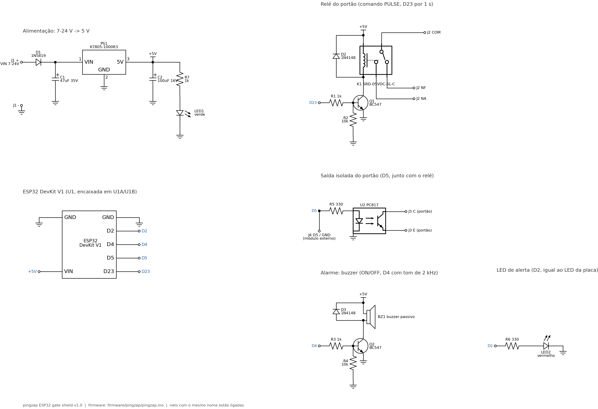

# Placa do ESP32 (pingzap gate shield v1.0)

Placa-base para o ESP32 DevKit V1 (30 pinos) com tudo o que o firmware
(`firmware/pingzap/pingzap.ino`) usa: relé do portão, saída isolada, buzzer,
LED de alerta e fonte de 7-24 V. O ESP32 encaixa em barras fêmea, sem solda,
e pode ser trocado ou regravado pelo USB.


| Arquivo | Para que serve |
|---|---|
| `pingzap-shield-gerber.zip` | **Arquivo enviado à PCBWay** (Gerber + furação) |
| `schematic.pdf` / `.svg` / `.png` | Esquemático |
| `bom.csv` | Lista de componentes |
| `render-3d.png` | Desenho 3D da placa montada, com o ESP32 encaixado |
| `preview-top.png` / `preview-bottom.png` | Prévia dos dois lados |
| `gen_pcb.py` / `gen_schematic.py` / `gen_3d.py` | Geradores (a placa é descrita em código) |

## Circuito



| ESP32 | Bloco | Comando MQTT |
|---|---|---|
| D23 | R1 1k → Q1 BC547 → relé K1 (5 V, 10 A), com diodo D2 e pull-down R2 | `PULSE`: 1 s ligado |
| D5 | R5 330 → optoacoplador PC817 → borne J3 (contato seco isolado). Também sai em J4 (D5/GND) para um módulo externo | `PULSE`: junto com o relé |
| D4 | R3 1k → Q2 BC547 → buzzer passivo (tom de 2 kHz), com diodo D3 e pull-down R4 | `ON` / `OFF` |
| D2 | R6 330 → LED2 vermelho (segue o LED da placa: 3 piscadas no Wi-Fi e alerta) | `ON` / `OFF` |
| VIN | J1 7-24 V → D1 (proteção de polaridade) → PS1 regulador chaveado 5 V 1 A → +5 V (ESP32, relé, buzzer, LED1 verde) | - |

Os resistores de 10k em D23 e D4 garantem que o relé e o buzzer fiquem
desligados enquanto o ESP32 está iniciando.

Ligação no portão: use **COM + NA** do borne J2 (ou C + E do J3) em paralelo
com a botoeira da central do portão. A saída J3 é isolada, mas só aceita
sinal de botoeira (até 50 mA e 35 V). O relé J2 serve para qualquer central.

## Pedido na PCBWay

1. Em <https://www.pcbway.com/orderonline.aspx> (PCB Instant Quote), clique
   em **Quick-order PCB** e envie `pingzap-shield-gerber.zip`. As medidas
   são lidas do arquivo.
2. Confira e escolha:

   | Opção | Valor |
   |---|---|
   | Size | 100 x 70 mm |
   | Layers | 2 |
   | Material | FR-4, TG130 |
   | Thickness | 1.6 mm |
   | Min track/spacing | 6/6 mil (a placa usa 0,40 mm / 0,40 mm) |
   | Min hole size | 0.3 mm (a menor broca é 0,75 mm) |
   | Solder mask | Green (ou outra cor) |
   | Silkscreen | White |
   | Surface finish | HASL lead free |
   | Copper weight | 1 oz |
   | Quantity | 5 (mínimo) |

3. Antes de pagar, confira a prévia no visualizador de Gerber da PCBWay.

Montagem: todos os componentes são PTH, para soldar à mão (veja `bom.csv`).
Se quiser montagem pela PCBWay, envie o `bom.csv` junto, no serviço "PCB
Assembly".

## Antes de mandar fabricar

- **Meça o seu ESP32.** A placa usa o DOIT DevKit V1 de 30 pinos, com
  25,4 mm entre as fileiras. Algumas versões têm 22,86 mm. A antena fica
  para fora da borda de cima.
- **Relé:** a pinagem segue o Songle SRD-05VDC-SL-C. Depois de montar,
  confira com o multímetro: com o relé desligado, COM e NF têm
  continuidade.
- **Regulador:** PS1 é um módulo chaveado no formato do 7805 (K7805-1000R3,
  R-78E5.0-1.0 ou equivalente, pinos VIN-GND-5V). Um LM7805 linear também
  cabe, mas esquenta acima de 9 V.
- Não alimente pelo J1 e pelo USB ao mesmo tempo, a não ser que o seu
  DevKit tenha diodo na entrada do USB (a maioria tem).

## Regerar os arquivos

A placa é descrita em `gen_pcb.py`: posição de cada componente, trilhas e
nets. O script gera os Gerbers e o plano de terra nas duas faces. Depois faz
um DRC (isolação mínima de 0,25 mm, borda, anel e distância entre furos) e
confere a conectividade (cada net é uma peça só de cobre, sem curto). Se algo
falhar, ele não grava nada.

```sh
pip install -r requirements.txt
python3 gen_pcb.py        # Gerbers, zip, BOM e prévias
python3 gen_schematic.py  # esquemático
python3 gen_3d.py         # desenho 3D (render-3d.png)
```

O `gen_3d.py` usa as mesmas posições, trilhas e serigrafia do `gen_pcb.py`,
com modelos simplificados de cada componente. Ele renderiza fora da tela
(pyvista); a imagem é só ilustrativa, e as medidas que valem são as dos
Gerbers.
